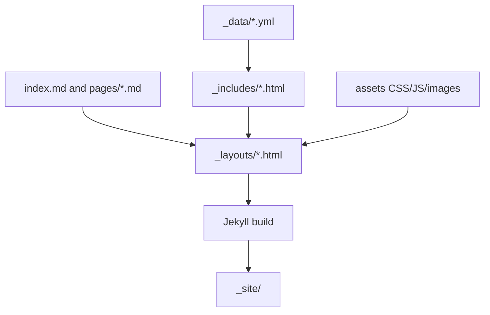

# Site Architecture

## Summary

1.  [Objective](#objective)
2.  [System Boundary](#system-boundary)
3.  [Components](#components)
4.  [Flow](#flow)
5.  [Trade-Offs](#trade-offs)
6.  [Validation](#validation)
7.  [Next Steps](#next-steps)

## Objective

This site is a static GitHub Pages portfolio built with Jekyll. The architecture
keeps content, presentation, and local runtime concerns separate so the
portfolio can evolve without turning the home page into a single long README.

## System Boundary

This repository contains the public website and its frontend source:

- site pages;
- structured content records;
- reusable Liquid includes;
- Jekyll layouts;
- CSS, JavaScript, and public images;
- Docker-based local preview.

The site is static at runtime. Jekyll resolves layouts, includes, and data files
at build time, then serves generated HTML, CSS, JavaScript, and images.

## Components

- `_data/navigation.yml`: primary navigation items.
- `_data/case_studies.yml`: structured portfolio cards and links.
- `_data/research.yml`: education, awards, and publications.
- `_data/writing.yml`: public writing lanes.
- `pages/*.md`: public top-level pages with stable permalinks.
- `_includes/case-card.html`: reusable case-study card.
- `_includes/header.html` and `_includes/footer.html`: shared site chrome.
- `_layouts/default.html`: base page shell.
- `assets/css/main.css`: visual system and responsive layout.
- `assets/js/main.js`: mobile navigation behavior.
- `Dockerfile`: local Ruby/Jekyll runtime.
- `docker-compose.yml`: local preview command.

## Flow



## Trade-Offs

Jekyll keeps the site compatible with GitHub Pages and avoids a frontend build
step. The trade-off is that interactive behavior should stay modest unless the
site later adopts a dedicated JavaScript toolchain.

Docker remains the local runtime default so contributors do not need Ruby
installed on the host machine.

## Validation

Run a full image build and Jekyll build:

```bash
docker build -t marcosgvjunior-github-io .
docker run --rm marcosgvjunior-github-io bundle exec jekyll build --trace
```

## Next Steps

- Add screenshots or generated visuals for projects that do not yet have
  strong image assets.
- Add dedicated pages for completed case studies in computer vision, text
  analytics, and RAG evaluation.
- Add lightweight accessibility and link checks when the site grows.
