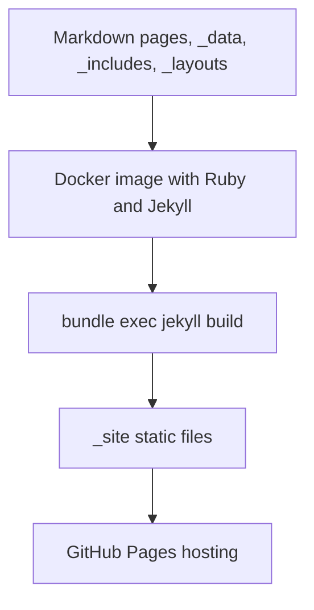
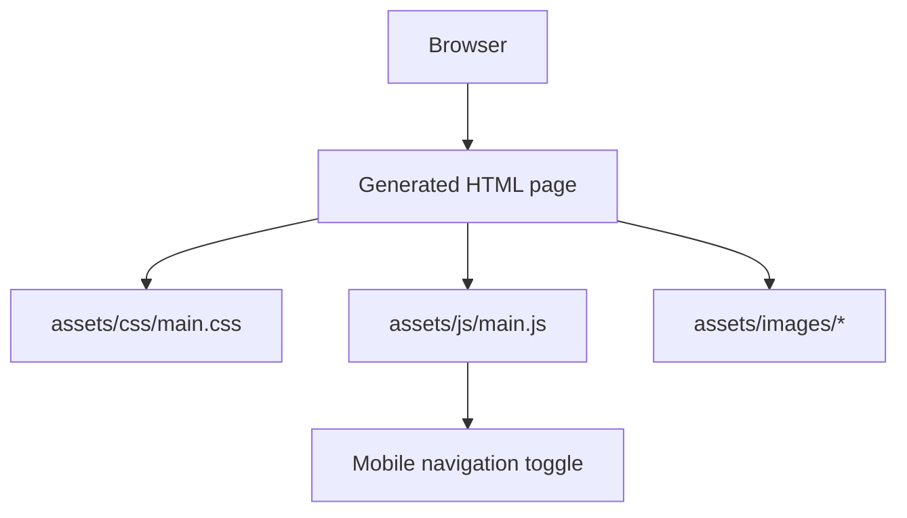

# Application Flow

## Summary

1.  [Objective](#objective)
2.  [Build Flow](#build-flow)
3.  [Request Flow](#request-flow)
4.  [Editing Flow](#editing-flow)
5.  [Validation Flow](#validation-flow)

## Objective

This document describes how source files become a static portfolio site and how
the browser loads the generated pages. It mirrors the flow-style documentation
used in full-stack projects while staying accurate to Jekyll.

## Build Flow



## Request Flow



The runtime site is static. JavaScript is used only for small
progressive-enhancement behavior such as the mobile menu.

## Editing Flow

1.  Update structured content in `_data/` when possible.
2.  Update page copy in `index.md` or `pages/*.md`.
3.  Update reusable markup in `_includes/`.
4.  Update layout shells in `_layouts/`.
5.  Update styling in `assets/css/main.css`.
6.  Update small interactions in `assets/js/main.js`.

## Validation Flow

```bash
docker build -t marcosgvjunior-github-io .
docker run --rm marcosgvjunior-github-io bundle exec jekyll build --trace
git diff --check
```
