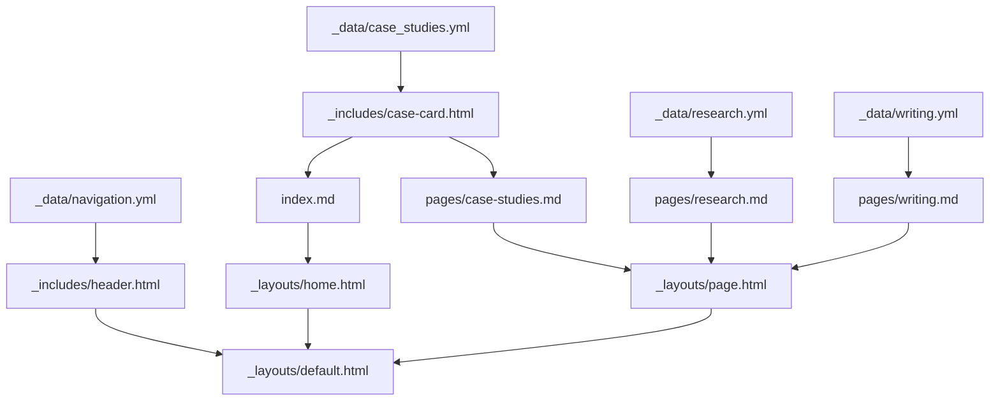
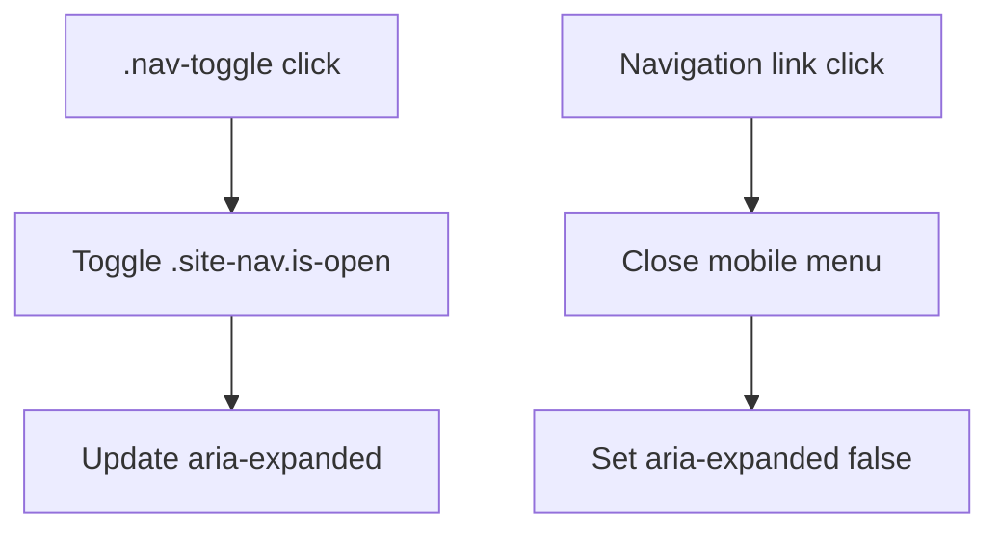

# Logic Flow

## Summary

1.  [Purpose](#purpose)
2.  [Template Map](#template-map)
3.  [Client-Side Behavior](#client-side-behavior)

## Purpose

This document maps the small amount of site logic so the Jekyll structure feels
closer to a conventional web frontend project.

## Template Map

## Client-Side Behavior

The site intentionally avoids heavy JavaScript until there is a specific
portfolio feature that benefits from it.
